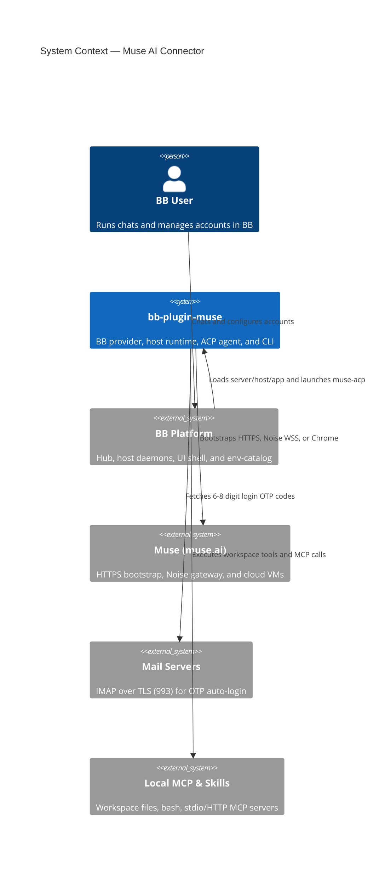
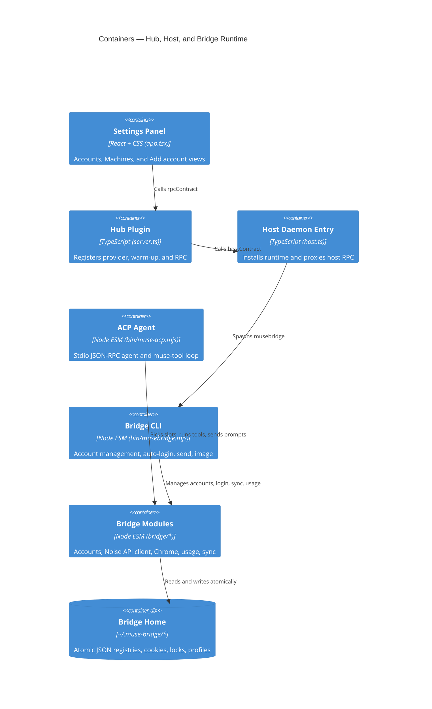
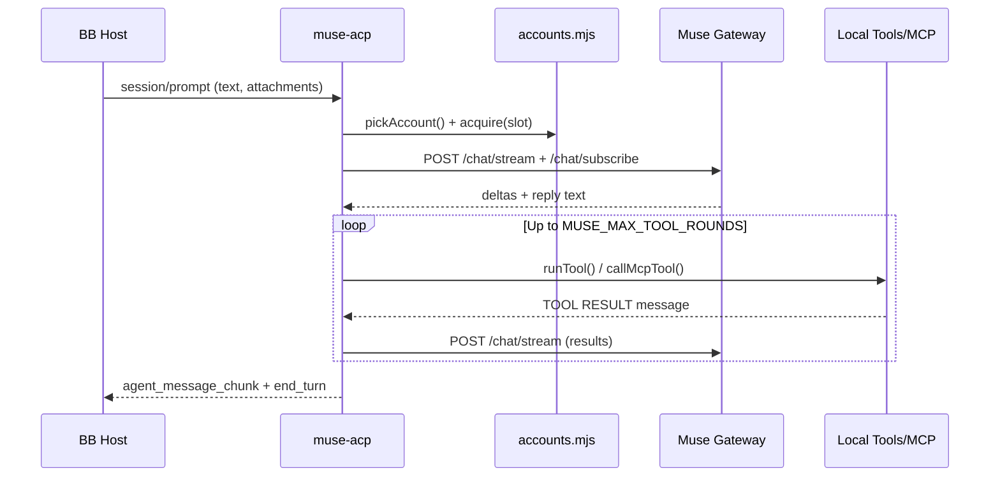
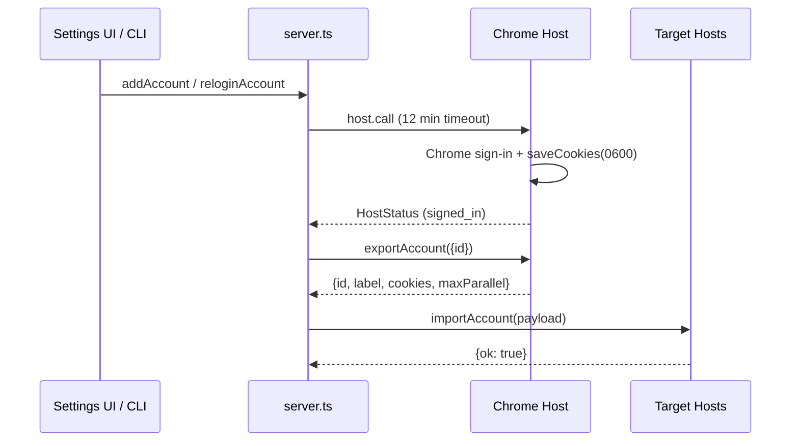

# Architecture

The plugin splits across three BB execution planes—Hub (`server.ts`), UI (`app.tsx`), and Host Daemon (`host.ts`)—plus a self-installed Node runtime (`muse-acp` and `musebridge`) that talks to `muse.ai` over a Noise-encrypted WebSocket tunnel or persistent Chrome.

## System Context

Sources: `package.json:22-34`, `server.ts:276-350`, `host.ts:251-338`, `bin/muse-acp.mjs:442-666`, `bridge/auto-login.mjs:140-237`, `bridge/acp-mcp.mjs:216-253`.

## Containers

Sources: `app.tsx:813-912`, `server.ts:93-120,232-459`, `host.ts:84-339`, `bin/muse-acp.mjs:1-15,617-709`, `bin/musebridge.mjs:1-33,982-1040`, `bridge/paths.mjs:5-17`, `bridge/json-file.mjs:35-176`.

## Building Blocks

- **Hub entry (`server.ts`):** Defines `SETTINGS`, registers the `muse` ACP provider and `muse-spark` / `muse-image` models, runs the 10-minute `runtime-warmup` background service, merges cross-host usage, and orchestrates cookie sync (`server.ts:207-458`). Details in [API Reference](api.md) and [BB Provider & ACP Agent](features/bb-provider-and-acp-agent.md).
- **Host entry (`host.ts`):** Exports `experimental_providerBridge`, checks Chrome/shim availability, triggers `installRuntime`, and executes `musebridge` subprocesses for `hostContract` calls (`host.ts:12,176-338`). Details in [Settings Panel & i18n](features/settings-panel-and-i18n.md).
- **UI entry (`app.tsx`, `i18n.ts`, `usage-format.ts`, `app.css`):** Renders the `muse` navigation panel and settings summary section in English or Russian using `--pk-*` tokens (`app.tsx:515-912`, `i18n.ts:213-234`, `app.css:1-27`). Details in [Settings Panel & i18n](features/settings-panel-and-i18n.md).
- **ACP agent (`bin/muse-acp.mjs`, `launch-spec.mjs`):** Maps BB sessions to Muse chats in `sessions.json`, strips/filters BB system prompts, acquires account slots, and executes `muse-tool` blocks and MCP servers (`launch-spec.mjs:6-24`, `bin/muse-acp.mjs:102-117,420-667`). Details in [BB Provider & ACP Agent](features/bb-provider-and-acp-agent.md).
- **Account pool & auth (`bridge/accounts.mjs`, `bridge/cookies.mjs`, `bridge/auto-login.mjs`, `bridge/hub-sync.mjs`, `bridge/sync.mjs`, `bridge/usage.mjs`):** Manages `~/.muse-bridge/` registries, slot locks, Playwright/IMAP OTP sign-in, hub/SSH cookie propagation, and Next-Action quota fetching. Details in [Account Pool & Auth](features/account-pool-and-auth.md).
- **Transport layer (`bridge/protocol/*`, `bridge/session.mjs`, `bridge/cache.mjs`, `bridge/permissions.mjs`):** Implements the default HTTPS + Noise XX WebSocket client and the Playwright Chrome fallback reading `hatch-chat-cache` IndexedDB. Details in [Direct API & Browser Transport](features/direct-api-and-browser-transport.md).
- **CLI & DeepSWE kit (`bin/musebridge.mjs`, `bench/deepswe/*`):** Standalone CLI surface and isolated Docker/SSH benchmark harness (`bench/deepswe/relay.mjs`, `bench/deepswe/muse_agent.py`). Details in [CLI & Benchmark](features/cli-and-benchmark.md).

## Key Flows

### BB chat prompt execution (`muse-acp`)

Sources: `bin/muse-acp.mjs:420-594`, `bridge/accounts.mjs:316-389`, `bridge/acp-tools.mjs:236-266,391-426`, `bridge/protocol/api.mjs:208-354`.

### Multi-host login and cookie distribution

Sources: `server.ts:399-443`, `host.ts:265-311`, `bridge/hub-sync.mjs:11-36`, `bridge/cookies.mjs:31-34`.

## Invariants

- **Compile-time plugin version:** `host.ts` reads `PLUGIN_VERSION` from `version.ts` rather than reading `package.json` at runtime because BB ships `host.mjs` standalone (`version.ts:1-3`, `host.ts:10`).
- **Workspace confinement:** Every local tool resolves paths through `resolveSessionPath(cwd, p)` and throws `tool_error` if the resolved path escapes `cwd` (`bridge/acp-tools.mjs:311-317`).
- **Atomic locked state writes:** Mutations to `accounts.json`, `sessions.json`, and `sync.json` use `updateJson` (`<file>.lock` via `linkSync`, temp file + `renameSync`), while `readJson` retries transient parse failures instead of overwriting with `fallback` (`bridge/json-file.mjs:35-176`).
- **In-memory cookie transit:** Cookies are saved with mode `0600` inside `0700` account directories on hosts (`bridge/cookies.mjs:16-34`), passed via `stdin` over SSH (`bridge/sync.mjs:72-116`), and held in hub memory only during `syncAcrossHosts` (`server.ts:387-414`, `bridge/hub-sync.mjs:1-36`).
- **HTTP/1.1 WebSocket dial:** `gateway.mjs` uses the `ws` package rather than Node's `fetch`/undici `WebSocket` so ALPN does not negotiate HTTP/2 (`bridge/protocol/gateway.mjs:3,317-328`).
- **Approval safety:** Non-monetary Muse approval cards are clicked with `Always allow`, while cards matching `MONEY_RE` return `"ask"` and are left for the owner; `Deny` is never clicked (`bridge/permissions.mjs:8-20,100-140`).

## Cross-cutting concerns

- **Authentication & sessions:** Browser profiles persist under `~/.muse-bridge/profiles/<id>/`, cookies for `muse.ai` and `auth.meta.com` are exported to `cookies.json`, and HTTP `401`/`403` responses mark the account `signed_out` and fall back to Chrome on chat turns (`bin/muse-acp.mjs:298-308`, `bridge/protocol/api.mjs:387-399`).
- **Concurrency & locks:** Each account allows `1..50` parallel slots (`DEFAULT_MAX_PARALLEL = 10`), backed by `O_EXCL` (`flag: "wx"`) lock files under `~/.muse-bridge/locks/` reclaimed when the PID exits or age exceeds 30 minutes (`bridge/accounts.mjs:6-8,137-143,316-359`).
- **Error classification:** Unrecoverable auth errors emit `NonRetriableError: muse signed out: <id>` to BB, while transient faults and exhausted blockless nudges emit `RetriableError: [muse_unavailable|muse_no_tool] ...` (`bin/muse-acp.mjs:27,455,609-612`).
- **Localization:** UI strings in `app.tsx` are exclusively keyed through `t()` in `i18n.ts` (`en`/`ru` parity enforced by tests), and `session.mjs` forces Chrome `--lang=en-US` while using language-independent selectors (`i18n.ts:213-234`, `bridge/session.mjs:18,24-31`, `tests/ui-layout.test.mjs:114-139`).

<!-- lane-pilot:backlinks -->
## Referenced by

- [Muse AI Connector — Overview](overview.md)
