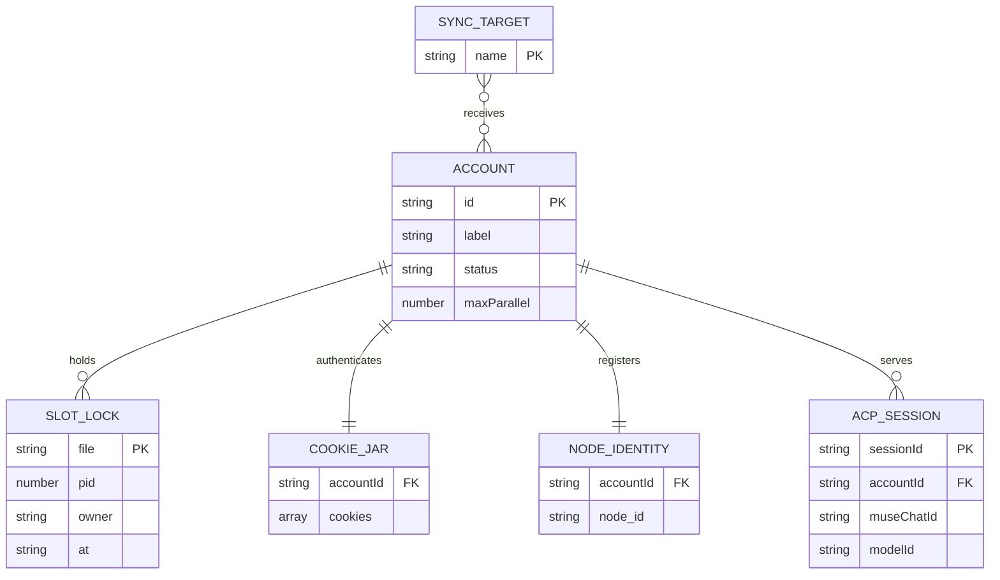

# Data Model

`bb-plugin-muse` stores no SQL database; all persistent state lives as atomically locked JSON files and Chrome profiles under `MUSE_BRIDGE_HOME` (default `~/.muse-bridge/`), plus read-only IndexedDB records inside Muse's web app cache.

## Schema overview

Sources: `bridge/accounts.mjs:11-45`, `bridge/cookies.mjs:7-14`, `bridge/protocol/api.mjs:31-45`, `bin/muse-acp.mjs:106-117`, `bridge/sync.mjs:17-48`.

## Entities

### Account registry (`~/.muse-bridge/accounts.json`)

Tracks registered Muse accounts, profile paths, sign-in state, and per-account concurrency limits (`bridge/accounts.mjs:34-36,47-49`).

| Field | Type | Meaning |
|---|---|---|
| `version` | integer | Registry schema version; fixed at `1` (`bridge/accounts.mjs:48,98`) |
| `accounts[].id` | string | Unique lowercase slug derived from `label` (`-2`, `-3` on collision), or `"default"` during migration (`bridge/accounts.mjs:57-73,84`) |
| `accounts[].label` | string | Human-readable account label or email address (`bridge/accounts.mjs:217`) |
| `accounts[].profileDir` | string | Absolute path to Chrome persistent profile directory (`~/.muse-bridge/profiles/<id>`) (`bridge/accounts.mjs:218`, `bridge/paths.mjs:15-17`) |
| `accounts[].status` | enum | Account sign-in state: `"unknown"`, `"signed_in"`, or `"signed_out"` (`bridge/accounts.mjs:9,254-263`) |
| `accounts[].maxParallel` | integer? | Optional concurrent chat slot cap (`1..50`); when omitted, falls back to `MUSE_MAX_PARALLEL` then `DEFAULT_MAX_PARALLEL` (`10`) (`bridge/accounts.mjs:7-8,179-185,282-294`) |
| `accounts[].createdAt` | ISO 8601 | Creation timestamp (`bridge/accounts.mjs:212,220`) |
| `accounts[].lastUsedAt` | ISO 8601 | Last slot usage timestamp used to break ties by oldest timestamp (`bridge/accounts.mjs:267-275,383-387`) |
| `accounts[].lastCheckedAt` | ISO 8601 | Last status update timestamp set by `setStatus()` (`bridge/accounts.mjs:260`) |

**Status lifecycle (`accounts[].status`):**

| From | To | Function | When |
|---|---|---|---|
| (none) | `unknown` | `addAccount` (`bridge/accounts.mjs:206-228`) / `migrateDefaultIfNeeded` (`bridge/accounts.mjs:75-94`) | Account registered before sign-in completes or migrated from `profiles/default` |
| `unknown` / `signed_out` | `signed_in` | `setStatus` (`bridge/accounts.mjs:254-264`) | Interactive Chrome sign-in succeeds, IMAP OTP succeeds, `accounts import` runs, or `driver.isSignedIn()` returns `true` (`bin/muse-acp.mjs:458`) |
| `signed_in` / `unknown` | `signed_out` | `setStatus` (`bridge/accounts.mjs:254-264`) | `doctor`/`accounts check` finds signed-out Chrome, API receives HTTP `401`/`403` (`bin/muse-acp.mjs:301-303,596-598`), or `auto-login` hits `region_waitlist` / `signin_timeout` (`bridge/auto-login.mjs:543,586`) |

**Invariants & ownership:** Every mutation goes through `updateJson` (`bridge/accounts.mjs:106-111`). If `accounts.json` is missing and `profiles/default` exists, `migrateDefaultIfNeeded()` creates account `"default"` automatically (`bridge/accounts.mjs:75-94`). Written by `bridge/accounts.mjs`, `bin/musebridge.mjs`, `bridge/auto-login.mjs`, and `bin/muse-acp.mjs`; read by `host.ts` via `musebridge accounts list --json` (`host.ts:229-239`).

### Account cookies and node identity (`~/.muse-bridge/accounts/<id>/`)

Stores per-account authentication cookies (`cookies.json`) and persistent Muse node UUID (`node.json`) inside a mode `0700` directory (`bridge/cookies.mjs:7-34`).

| File & Field | Type | Meaning |
|---|---|---|
| `cookies.json` (`[]`) | array | Playwright cookie objects (`name`, `value`, `domain`, `path`, `expires`, `secure`, `httpOnly`) for `https://muse.ai` and `https://auth.meta.com`; mode `0600` (`bridge/cookies.mjs:23-34`, `bridge/session.mjs:258-260`) |
| `node.json` (`node_id`) | UUID string | Stable client node identifier generated on first API client connection and sent to `/api/nodes/register` and `/chat/stream`; mode `0600` (`bridge/protocol/api.mjs:31-45,53,154`) |

**Writers & readers:** `cookies.json` is written by `saveCookies` after Chrome login, `accounts refresh`, `accounts auto-login`, and `accounts import`; read by `loadCookies` in `createMuseClient`, `fetchAccountUsage`, `syncAccount`, and `accounts export` (`bridge/cookies.mjs:31-46`). `node.json` is lazily created and read by `loadOrCreateNodeId` (`bridge/protocol/api.mjs:31-45`).

### Slot locks (`~/.muse-bridge/locks/<id>.lock`, `<id>.<n>.lock`)

Coordinates concurrent chats per account without an external lock daemon (`bridge/accounts.mjs:38-45`).

| Field | Type | Meaning |
|---|---|---|
| `pid` | integer | OS process ID holding the slot; checked via `process.kill(pid, 0)` (`bridge/accounts.mjs:119-127,320`) |
| `owner` | string | Caller tag such as `"muse-acp:<sessionId>"`, `"musebridge-send"`, or `"pid:<pid>"` (`bridge/accounts.mjs:321`, `bin/muse-acp.mjs:343`) |
| `at` | ISO 8601 | Lock acquisition timestamp; locks older than `STALE_LOCK_MS` (`30` minutes) are treated as stale (`bridge/accounts.mjs:6,137-143,322`) |

**Invariants & cleanup:** `slotPath` maps slot `0` to `<id>.lock` and slots `1..N-1` to `<id>.<n>.lock` (`bridge/accounts.mjs:42-45`). `acquire` creates locks atomically with `flag: "wx"`, `isStaleLock` reclaims dead PIDs or locks older than `STALE_LOCK_MS`, and `removeAccount` unlinks all `slotLockFiles` (`bridge/accounts.mjs:137-143,234-246,316-357`).

### ACP session store (`~/.muse-bridge/sessions.json`)

Maps each BB ACP session (`session.id`) to its pinned `accountId`, `museChatId`, `cwd`, and `modelId` (`bin/muse-acp.mjs:98-117`).

| Field | Type | Meaning |
|---|---|---|
| `accountId` | string \| null | Pinned Muse account ID selected on the first prompt (`bin/muse-acp.mjs:110,433-441`) |
| `museChatId` | string \| null | Muse thread UUID (`session_id`) so follow-ups and post-cancel resumes stay in one Muse chat (`bin/muse-acp.mjs:111,496-503`) |
| `cwd` (`session.cwd`) | string | Absolute workspace root for local `muse-tool` execution (`bin/muse-acp.mjs:112,636`) |
| `modelId` | string | Active model ID: `"muse-spark"` (default) or `"muse-image"` (`bin/muse-acp.mjs:60-65,113,647-655`) |

**Writers & readers:** Updated under `updateJson` lock in `saveSession` (`bin/muse-acp.mjs:106-117`) on `session/new`, `session/set_model`, account assignment, and `onChatId`; read by `loadStore` / `getSession` (`bin/muse-acp.mjs:102-104,312-329`).

### SSH sync targets, usage action cache, and runtime directories

| Path | Fields / Layout | Meaning & Retention |
|---|---|---|
| `~/.muse-bridge/sync.json` | `{ targets: [{ name: string }] }` | Mode `0600` list of SSH host aliases receiving `cookies.json` via `musebridge sync` (`bridge/sync.mjs:17-61`) |
| `~/.muse-bridge/cache/usage-action.json` | `{ actionId: string }` | Cached Next.js `fetchSubscriptionAction` hash; overwritten on discovery and deleted on `409` or unreadable response (`bridge/usage.mjs:33-67,238-243`) |
| `~/.muse-bridge/profiles/<id>/` | Chromium user-data directory | Returned by `profileDir` (`bridge/paths.mjs:15-17`); deleted only when `removeAccount` runs with `purge: true` (`bridge/accounts.mjs:234,247`) |
| `~/.muse-bridge/runtime/<version>/` | Checked-out runtime + `current` symlink + `bin/*` shims | Keeps only the 2 newest `<version>` directories by mtime via `pruneVersions`; older versions and `*.tmp-*` build dirs are removed (`bridge/runtime-install.mjs:13,149-170,216-220`) |

### Chrome IndexedDB (`hatch-chat-cache`)

Read-only browser cache inspected by the Playwright fallback transport (`bridge/session.mjs:52-71,101-113`, `bridge/cache.mjs:16-71`).

| Object store | Fields parsed | Meaning |
|---|---|---|
| `side-transcripts` | `schemaVersion`, `sessionId`, `transcriptRevision`, `hasMore`, `messageIds[]`, `messagesById` | Requires `schemaVersion === 4`; yields ordered `{ id, role, content, streaming, createdAt, model }` messages (`bridge/cache.mjs:16-42`) |
| `side-chat-lists` | `cachedAtMs`, `sessions[]` (`session_id`, `title`, `snippet`, `updated_at`, `created_at`, `archived`, `pinned`, `status`) | Selects record with largest `cachedAtMs` and sorts chats newest `updatedAt` first (`bridge/session.mjs:109-113`, `bridge/cache.mjs:57-71`) |

## Ownership

- **Account pool, locks, and profiles:** Owned by `bridge/accounts.mjs`, `bridge/cookies.mjs`, and `bridge/paths.mjs`.
- **ACP sessions:** Owned by `bin/muse-acp.mjs`.
- **Sync targets and usage action cache:** Owned by `bridge/sync.mjs` and `bridge/usage.mjs`.
- **Runtime versions and shims:** Owned by `bridge/runtime-install.mjs`.
- **Cross-process JSON locking:** Owned by `bridge/json-file.mjs`.

<!-- lane-pilot:backlinks -->
## Referenced by

- [Muse AI Connector — Overview](overview.md)
